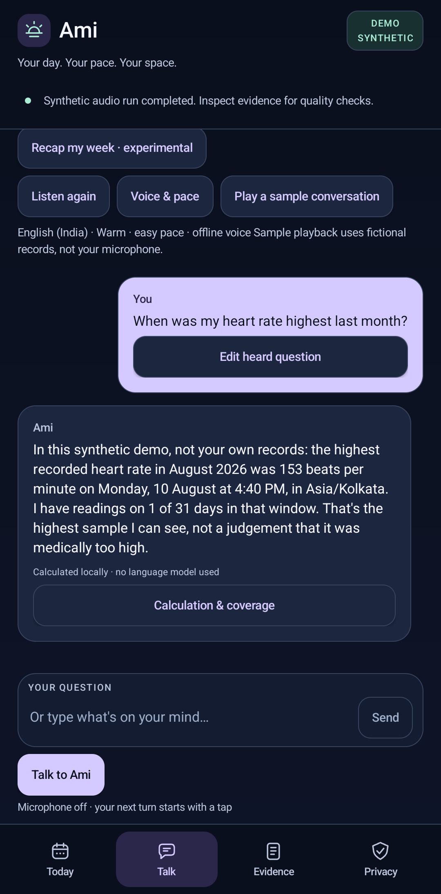

# Ami: a private voice companion with Foundry Local

**Your day. Your pace. Your space.**

**Private review repository:** [kalai4390/ami-foundry-local](https://github.com/kalai4390/ami-foundry-local). Access is restricted; this is not a public reader link yet. No license has been added. Public release and licensing require a separate decision.

Current source: **Ami 0.3.4-preview**, with call-aware voice checks and the Health Connect return-to-app runner fix. It passes 171 JVM tests, both builds/lint, and a hash-verified phone smoke/conversation replay. [Device findings](./docs/DEVICE-FINDINGS.md) distinguish this update from the full **0.3.3-preview** SDK/media baseline: two real phone videos, five compositor screenshots, a welcome frame and a separate offline voice preview. The [media provenance](./docs/demo/ami-provenance.json) retains the exact original APK; older results are not relabelled as a new replay. See [what was actually validated](./docs/SHOWCASE-VALIDATION.md). The stable `dev.daylight.local` application ID permits an in-place upgrade.

**Your data. Your voice. Your phone.** A native Android reference implementation that combines local speech recognition, permissioned wearable context, calculated answers and an installed offline voice.

**New physical-microphone demo:** the [46-second current-build recording](./docs/demo/ami-microphone.mp4) captures actual Android TTS output after a known question is played from a laptop speaker into the phone microphone. No direct ASR file injection or added voiceover is used. A separate unmirrored turn, replay, interruption and Stop also completed; [reconnection evidence](./docs/evidence/ami-reconnect-validation.json) and [media provenance](./docs/demo/ami-microphone-provenance.json) distinguish these checks from human voice-quality evaluation. The personal-data blocker is now directly observed: Health Connect's Samsung-specific source screen shows **No data**, despite the required permissions.

- [Read the hands-on blog](./docs/BLOG.md).
- [Watch the actual device demos and inspect the screenshots](./docs/DEMO-GUIDE.md).
- [Check the evidence and limitations](./docs/SHOWCASE-VALIDATION.md).
- [Inspect the clean-source reproduction](./docs/evidence/reproducibility.json): 171 tests, both builds/lint and matching APK hashes on the same host/toolchain/signing environment.



The demonstration uses **fictional records and prerecorded synthetic speech**, never the owner's health records. Foundry Local Whisper does speech recognition. Application code routes normal questions and calculates answers. The separately confirmed Qwen experiment selects precomputed fact cards. Android TTS—not Foundry—provides the offline speaking voice. This is not an unrestricted LLM health advisor, a medical product or a claim of whole-device zero network traffic.

## Build from a clean checkout

1. Install **JDK 17**, **Gradle 8.13**, and Android SDK platform **36**, build tools and platform-tools. Set `JAVA_HOME` and `ANDROID_HOME`; review and accept Android SDK licenses yourself. PowerShell **7.4+** is required for the scripts.
2. Review the [Foundry Local Android 0.1.6 release](https://github.com/microsoft/FoundryLocalAndroid/releases/tag/v0.1.6) and its SDK terms. Download the official **IPC AAR**, not the embedded AAR, into `.tools/foundry-local-ipc-sdk-0.1.6.aar`. The build verifies the release hash. SDK/runtime binaries and model weights are deliberately not redistributed here.
3. Put Gradle 8.13 in `.tools/gradle-8.13`, or supply its executable path explicitly:

```powershell
.\scripts\build.ps1 `
  -GradlePath 'C:\tools\gradle-8.13\bin\gradle.bat' `
  -FoundryAar 'C:\tools\foundry-local-ipc-sdk-0.1.6.aar'
```

The paths above are examples. Use your installed locations. The script runs `:core:test`, `:app:assembleDebug` and `:app:lintDebug`. For both build variants and a hash-bound local capture manifest:

```powershell
.\scripts\validate-build.ps1 `
  -GradlePath 'C:\tools\gradle-8.13\bin\gradle.bat' `
  -FoundryAar 'C:\tools\foundry-local-ipc-sdk-0.1.6.aar'
```

The [validator](./scripts/validate-build.ps1) writes `runtime/build-validation.json` for your build without overwriting the author's published results. Pass that path to the reconnect/capture scripts when using a newly built APK; never edit a recorded hash to bypass verification. The release APK is **unsigned**, not ready for distribution. This project uses Kotlin/Gradle and does not require npm. If you separately acquire media tooling from npm in a policy-managed environment, use the approved Microsoft mirror rather than changing the global registry.

## Run on Android

Use a supported Android 13+ device and a compatible Foundry Local companion for the pinned IPC SDK. Follow the [official IPC setup](https://github.com/microsoft/FoundryLocalAndroid/blob/v0.1.6/docs/INTEGRATION_GUIDE.md#ipc-setup). This repository was exercised on a Motorola g35 / Android 16, not every Android device.

```powershell
$adb = Join-Path $env:ANDROID_HOME 'platform-tools/adb.exe'
& $adb install -r .\app\build\outputs\apk\debug\app-debug.apk
```

Open Ami yourself. It starts with the **DEMO / SYNTHETIC** badge. In Privacy, choose **Prepare local models** while the app is unlocked, foreground and on validated, unmetered Wi-Fi. The selected catalog packages are:

| Purpose | Catalog identifier | Observed advertised size |
| --- | --- | --- |
| Speech transcription | `openai-whisper-tiny-generic-cpu:4` | 131 MB |
| Optional recap selection | `qwen2.5-0.5b-instruct-generic-cpu:4` | 822 MB |

Catalog availability can change; the `:4` suffix is not a four-bit-quantization claim. IPC model caches are isolated per client app. The app checks exact cache handles, caps the advertised combined download at 1,000 MB, and never substitutes cloud inference.

Keep synthetic mode for demonstrations. Health Connect integration is optional and requests read-only, Samsung-origin records through explicit consent. A permission grant does not prove the provider has shared usable records. Microphone access is a separate user decision. **Play a sample conversation** is an explicit audible action; unattended test scripts use neither the microphone nor playback.

## Reproduce the synthetic checks

With the prepared app unlocked and foreground:

```powershell
.\scripts\run-device.ps1 -Mode smoke
.\scripts\run-device.ps1 -Mode audio
.\scripts\run-device.ps1 -Mode debrief
.\scripts\run-device.ps1 -Mode voice
```

Read both operational completion and quality results. Successful runs must report `healthReadAttempts: 0`. The audio suite evaluates five distinct synthetic WAVs. The recap checks a narrow output contract, not medical usefulness or general model reliability. The voice suite exports actual Android-synthesized WAVs without audible playback.

The historical `routing` experiment remains available to explain a rejected design. It is **not** the normal answer path. Do not treat a completed runtime call as a passed quality test.

## Where the implementation lives

| Component | Source |
| --- | --- |
| SDK connection, catalog, cache, load, speech/chat calls and cleanup | [FoundryRuntime](./app/src/main/java/dev/daylight/local/inference/FoundryRuntime.kt) |
| Voice input and output | [ShortRecorder](./app/src/main/java/dev/daylight/local/inference/ShortRecorder.kt), [LocalSpeaker](./app/src/main/java/dev/daylight/local/inference/LocalSpeaker.kt), [AudioReadiness](./app/src/main/java/dev/daylight/local/inference/AudioReadiness.kt) |
| Read-only Health Connect integration | [HealthReader](./app/src/main/java/dev/daylight/local/data/HealthReader.kt) |
| Pure Kotlin facts, dates, routing and strict model-output validation | [Core](./core/src/main/kotlin/dev/daylight/core/) |
| Native UI and lifecycle | [MainActivity](./app/src/main/java/dev/daylight/local/MainActivity.kt), [UI](./app/src/main/java/dev/daylight/local/ui/) |
| Reproducible device evaluation | [DebugRunner](./app/src/main/java/dev/daylight/local/DebugRunner.kt), [scripts](./scripts/) |
| Synthetic regression tests | [Core tests](./core/src/test/kotlin/dev/daylight/core/) |

## Privacy and scope

- No configured cloud inference or cloud speech fallback. Initial catalog/model setup uses connectivity; the tracker provider's independent cloud sync is outside this app's control.
- No background health access, Health Connect writes, always-listening service or automatic medical action.
- Health calculations are deterministic; missing or incomplete data is not converted into an invented personal result.
- Check-in storage is deliberate and local; no personal data is used for model training. Normal conversations do not persist automatically.
- Publication assets are synthetic. Device serials, owner diagnostics, local build logs, signing keys, credentials, SDK AARs, APKs and model weights are excluded from the repository package.
- Live microphone quality, useful personal-watch heart-rate data, radio-off cold starts and battery behavior remain separate validation tasks.

This source snapshot does not grant rights to the separate Microsoft SDK, model weights or third-party dependencies. Review their terms before redistribution or deployment. No open-source license grant is invented for the author's code; choose the intended repository license before a public release.
