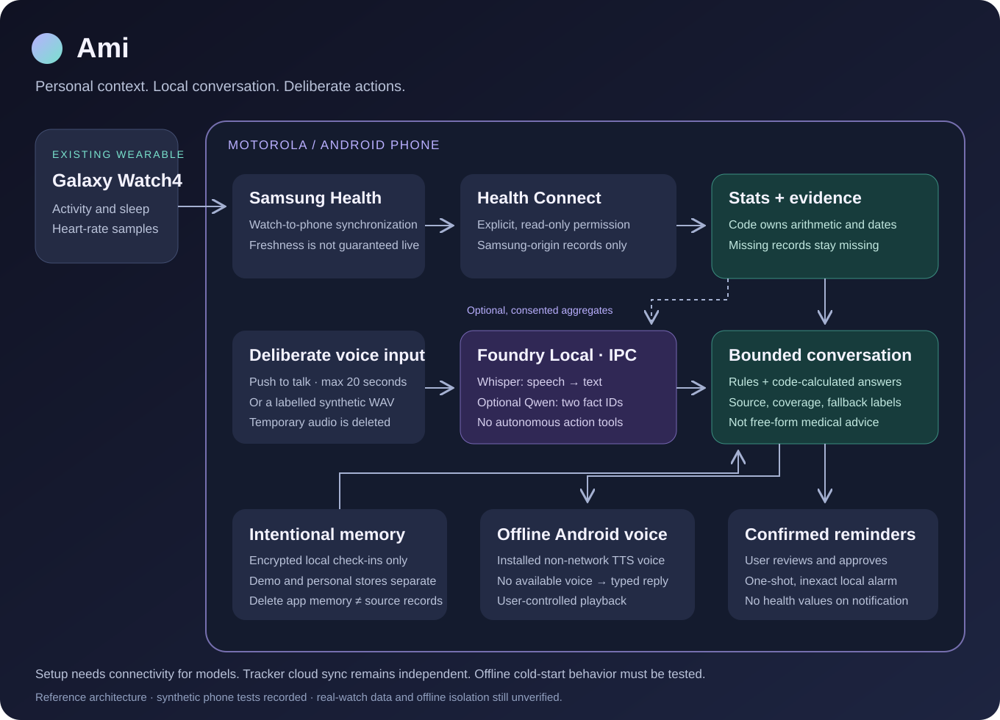
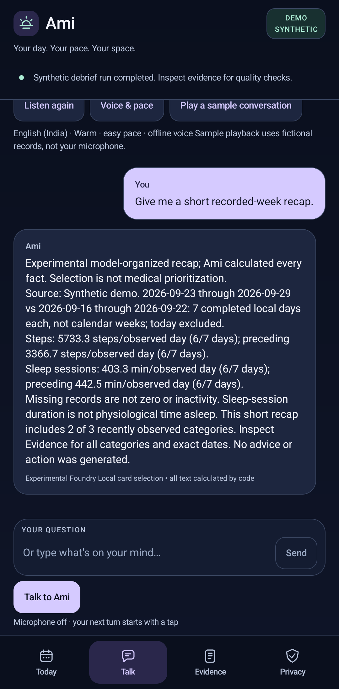
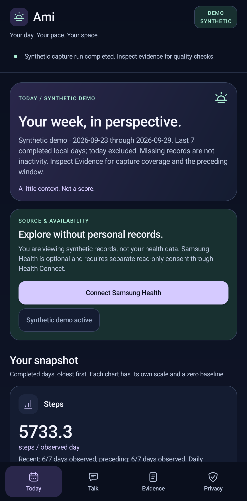
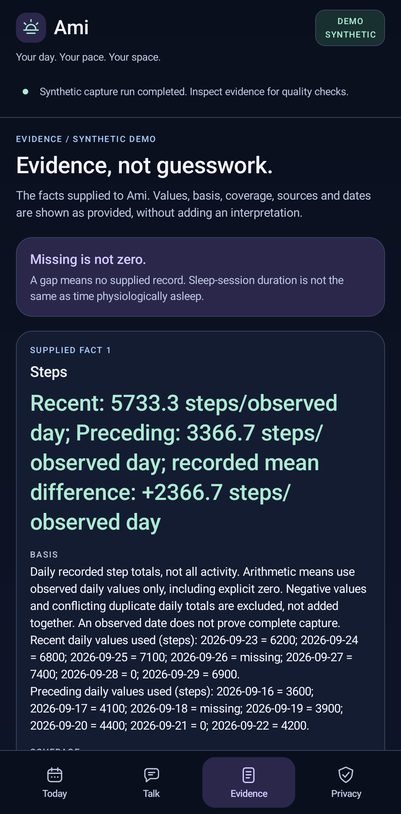
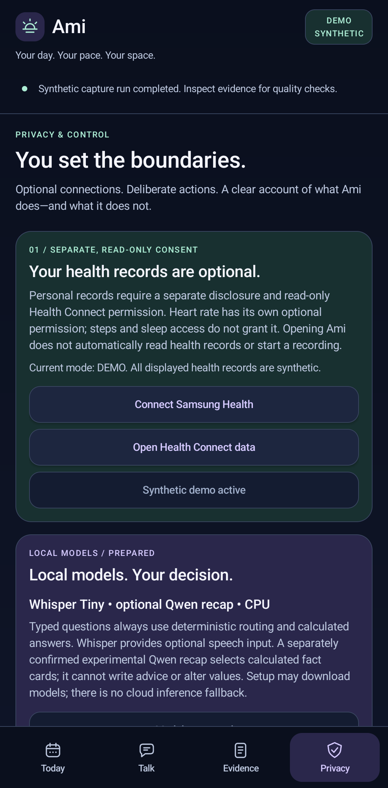

# Meet Ami: Building a Private Voice Companion with Foundry Local

## Build a personal voice experience with Foundry Local for Android

**Ami — Your day. Your pace. Your space.**

What if the app that records your day could also talk with you about it—without sending your question, voice recording or health context to a cloud model?

Not another dashboard to interpret. Not a generic chatbot giving the same advice to everyone. Something you could ask:

> “How did my sleep change this week?”
>
> “When was my heart rate highest last month?”
>
> “Why?”

That is the idea behind **Ami**, a native Android voice-companion prototype. It brings together Foundry Local speech recognition, permissioned wearable context, local calculations and an installed offline voice. The phone is the inference device, not a remote control for an assistant running on a laptop.


*A frame from the actual Ami recording, not a UI mockup. Microphone input begins only with a deliberate tap.*

The interesting part is not the wellness category. It is the application pattern: **make an experience personal by bringing local context to the interaction, rather than uploading that context to a cloud model.** This can inform other sensitive-data experiences, including private journals and accessibility assistants.

This article walks through that pattern with real SDK calls and a working implementation. The accompanying [author runbook](./AUTHOR-RUNBOOK.md) contains setup, reproducible checks and the capture plan.

**Full source and implementation:** [kalai4390/ami-foundry-local](https://github.com/kalai4390/ami-foundry-local). This is currently a **private review repository**, not a public blog-reader link. Public access and licensing must be settled before external publication.

**Scope of the demonstration:** all records are fictional. The Ami `0.3.3-preview` media below comes from a completed, hash-verified physical-phone capture on **September 30, 2026**: two actual screen recordings, five compositor screenshots and a welcome frame. The offline voice preview is a separate matching-build recording of synthesized output. Real Samsung heart-rate availability, live-microphone quality and radio-off cold starts are not yet verified. This is a reference prototype, not a deployed customer product or medical assistant. The Android SDK is pinned to **0.1.6**, not described as the latest release.

## 1. What Foundry Local contributes—and what the app still owns

The accompanying source is now **0.3.4-preview**, adding call-aware voice handling after further handset testing. The recordings retain their original **0.3.3-preview** labels and hashes; a source update is not a new physical recording. The [device findings](./DEVICE-FINDINGS.md) explain the distinction.

Foundry Local supplies the on-device model runtime and Kotlin APIs for discovering, downloading, loading and invoking models. In Ami, those capabilities support two different jobs:

| Part of the experience | Implementation | What becomes personal |
| --- | --- | --- |
| Understand a spoken question | Foundry Local runs Whisper Tiny on a short audio file | The user's question, transcribed locally |
| Answer supported questions about records | Application code reads permitted data, resolves dates and calculates facts | The answer reflects the available records and their coverage |
| Organize a weekly recap, optionally | Foundry Local runs Qwen on precomputed fact cards; code validates the selected IDs | The available context changes which cards can be selected |
| Speak the answer | An installed offline Android text-to-speech voice | A conversational rendering of the calculated answer |

**The normal answer text is not generated by an LLM.** That is a deliberate limit of this prototype, not a capability missing from the SDK: its chat API is used in the separate recap experiment. Foundry Local also does not supply Ami's Health Connect integration, arithmetic, memory controls or text-to-speech engine.

This distinction matters for an implementation article. “The app uses AI” should not conceal which parts use a model, which use code, and which still need work.

For example, “When was my heart rate highest?” requires timestamped samples and a calculation. A model cannot recover measurements that were never shared. Ami must distinguish no permission, no usable samples and an incomplete read—and never replace those states with invented personal numbers.

## 2. Keep the personal context on the local path



The intended wearable-data path is:

```text
Galaxy Watch4 → Samsung Health → Health Connect
                                   ↓ explicit read permission
                          Ami: facts + evidence
```

The voice path is:

```text
Tap to talk → temporary audio → Foundry Local / Whisper
                                      ↓ transcript
                          Ami: supported question + facts
                                      ↓ spoken reply
                            Offline Android TTS
```

The optional model-assisted recap is a separate branch:

```text
User confirmation → derived fact cards → Foundry Local / Qwen
                                               ↓ candidate card IDs
                           strict validation → original calculated text
```

[Samsung documents](https://developer.samsung.com/health/health-connect-faq.html) the watch-to-Samsung-Health and Samsung-Health-to-Health-Connect sharing boundaries. A connected watch or a granted permission does not establish that the requested data has reached Health Connect. Ami filters for Samsung-origin records rather than silently combining every provider.

### Personalization is not the same as fine-tuning

The data changes the context and the calculated answer; it does not change model weights. A different set of observed sleep sessions produces a different comparison. A missing day remains missing, rather than becoming a zero-minute night.

The normal voice path gives Whisper the audio, then handles the records in application code. The optional recap shares only derived weekly averages and observation counts with the Foundry Local companion, after a disclosure—not raw records or private check-in text. Both components run on the phone, but IPC still crosses an application/process boundary worth explaining to the user.

The precise privacy claim is **no cloud inference or cloud speech fallback in this implementation**. It is not “nothing on this phone ever uses a network.” Initial model acquisition requires connectivity; Samsung's independent account syncing is outside Ami's control. SDK telemetry is explicitly disabled. A whole-device zero-egress claim would require separate measurement; development-time USB inspection is also distinct from the application's local inference path.

## 3. Choose how the runtime reaches the phone

The pinned Android SDK offers [two deployment modes](https://github.com/microsoft/FoundryLocalAndroid/blob/v0.1.6/docs/IPC_AND_EMBEDDED_MODES.md):

| Choice | IPC: used here | Embedded: future packaging experiment |
| --- | --- | --- |
| Where inference runs | Separate Foundry Local service process | Inside your app process |
| Companion installation | Required | Not required |
| Runtime packaging | App includes the IPC AAR | App includes the embedded runtime AAR |
| Model storage | Service-managed, isolated per client app | App-managed |
| Main operational concern | Compatibility, disconnection and handle recovery | Package size, memory and native-process failures |

They expose the same Kotlin API, but switching modes still requires mode-specific testing. Include **one** deployment-mode AAR, not both. In IPC mode, models are not a shared cache available to every client app; downloading a model for another client does not prove it is ready for Ami.

IPC makes the runtime boundary visible in this prototype. Embedded mode is an interesting next step for a consumer product that should feel like one installation, but this article does not claim an embedded build was validated.

Windows hosts the build tools. Docker is not part of the phone's answer path. The Android integration below is not a desktop SDK example pointed at a remote endpoint.

## 4. Build the Android app against the pinned SDK

Ami uses JDK 17, Gradle 8.13, Android Gradle Plugin 8.13.0, Kotlin 2.1.20, compile/target SDK 36 and minimum API 33. Its Health Connect client is 1.1.0. These are this project's pins, not a promise that every alternative combination works.

Acquire the **IPC 0.1.6 AAR** from the [official release](https://github.com/microsoft/FoundryLocalAndroid/releases/tag/v0.1.6), verify its published checksum, and install a compatible Foundry Local service using the [IPC integration instructions](https://github.com/microsoft/FoundryLocalAndroid/blob/v0.1.6/docs/INTEGRATION_GUIDE.md#ipc-setup).

The [app build](../app/build.gradle.kts) resolves the AAR supplied to the build and checks its SHA-256. Its SDK dependencies include:

```kotlin
implementation(files(sdkArchive))
implementation("androidx.core:core-ktx:1.12.0")
implementation("org.jetbrains.kotlinx:kotlinx-coroutines-android:1.7.3")
```

The [manifest](../app/src/main/AndroidManifest.xml) includes internet access for setup and package visibility for `com.microsoft.foundrylocal.app`. Microphone and health permissions are separate, purpose-specific user decisions. The application does not grant them during model preparation.

From the cloned repository root, after setting `JAVA_HOME` and `ANDROID_HOME`:

```powershell
.\scripts\build.ps1 `
  -GradlePath 'C:\tools\gradle-8.13\bin\gradle.bat' `
  -FoundryAar 'C:\tools\foundry-local-ipc-sdk-0.1.6.aar'
```

Replace those two example tool paths with your actual locations. The script runs the core tests, debug build and debug lint by default. Install the resulting debug APK on an authorized device with the compatible companion. The [runbook](./AUTHOR-RUNBOOK.md#windows-setup-and-build) covers the full procedure. This is a Kotlin/Gradle implementation; npm is not required.

## 5. Follow the SDK lifecycle, not just a completion call

The following are focused excerpts from [FoundryRuntime](../app/src/main/java/dev/daylight/local/inference/FoundryRuntime.kt), not a replacement for its coroutine, consent and lifecycle handling. API types come from `com.microsoft.foundrylocal.api`.

### Connect and check compatibility

```kotlin
val manager = FoundryLocalManager.create(
    context = context.applicationContext,
    config = Configuration(
        appName = "Ami",
        disableTelemetry = true,
        logLevel = "Error"
    )
)
val compatibility = manager.checkCompatibility()
check(compatibility.isCompatible)
val catalog = manager.getCatalog()
val availableModels = catalog.listModels()
```

Treat catalog lookup as discovery, not proof of readiness. The app must separately establish that the exact model is cached and loaded. After a lost connection, the adapter closes the old manager and reacquires catalog/model handles rather than reusing stale ones.

The selected packages in this implementation are:

| Role | Exact catalog identifier | Observed advertised size |
| --- | --- | --- |
| Speech recognition | `openai-whisper-tiny-generic-cpu:4` | 131 MB |
| Experimental recap organization | `qwen2.5-0.5b-instruct-generic-cpu:4` | 822 MB |

The combined advertised download is 953 MB. That is **not** a RAM estimate or an inference benchmark. The app caps the selected advertised total at 1,000 MB. Catalog availability, actual storage, load behavior and device performance still need checking. These identifiers do not establish NPU acceleration or a particular quantization format.

### Provision explicitly, then reuse the cache

The underlying lifecycle starts with a model handle:

```kotlin
val audioModel = catalog.getModel("openai-whisper-tiny-generic-cpu:4")
if (!audioModel.isCached()) {
    audioModel.download(timeoutMinutes = 10)
}
check(audioModel.isCached())
```

Ami wraps this operation in **Prepare local models**, not the question handler. Its wrapper requires a focused, unlocked app and validated, unmetered Wi-Fi; it cancels when that network condition is lost. It never silently starts a large download because someone asks a question. The complete wrapper also reports progress and checks the combined model budget.

Preparing models is a setup phase. Asking questions is an inference phase. Keeping those distinct avoids surprising network use and makes failures understandable.

### Transcribe a local file

Once the audio model is cached:

```kotlin
if (!audioModel.isLoaded()) audioModel.load()
val transcription = audioModel.createAudioClient().transcribe(
    AudioTranscriptionRequest(
        filePath = audioFile.absolutePath,
        language = "en",
        temperature = 0.0f
    )
)
val question = transcription.text.trim()
```

This is the actual Foundry Local audio API. The source can be an intentionally recorded short clip or a labelled synthetic WAV. Ami's wrapper limits file size, applies a timeout and records model-load time separately from transcription time. It deletes temporary microphone audio after the turn or cancellation.

The transcript is visible and editable. That matters: an assistant should not turn an unclear recording into an unreviewable claim about someone's history.

### Use a chat model where generation adds value

The optional recap demonstrates the separate chat API:

```kotlin
val response = handle.createChatClient().completeChat(
    ChatCompletionRequest(
        messages = listOf(
            ChatMessage.system(DebriefOrganizer.SYSTEM_PROMPT),
            ChatMessage.user(DebriefOrganizer.prompt(cards))
        ),
        temperature = 0.0f,
        maxTokens = 32,
        topP = 1.0f
    )
)
val recap = DebriefOrganizer.resolve(cards, response.message?.content)
```

Here, `handle` is the loaded Qwen model and `cards` is the application's calculated fact catalog. The prompt offers allowed two-card permutations—for example, `[1,2]`. A strict parser rejects unknown IDs, duplicates, extra prose and malformed responses. It does not repair an invalid answer and call that model success. The renderer reuses the original facts and evidence.

This is ordinary chat completion plus an application-level contract, not an assumed structured-output feature. If the model is unavailable or its output is rejected, the UI labels the computed fallback. With too little data, no model call is needed.

Earlier model-routing experiments failed even simple subject classification, so they were removed from normal answers. The separately bounded recap protocol passes four synthetic contract checks on the hash-verified **Ami 0.3.3-preview** APK. That is a repeat of a small known fixture set, not a fresh holdout evaluation or proof of useful health reasoning. The [showcase ledger](./SHOWCASE-VALIDATION.md) and [sanitized phone evidence](./evidence/ami-phone-validation.json) separate those results from the failed routing design.



*Actual Android compositor screenshot from the completed capture. The model selects cards; every displayed fact and sentence remains application-calculated.*

The **22.10-second recap recording** shows the separate experimental path on the same phone. Its matching run accepted all four model-output contracts and handled the empty/one-category cases without a model call. This is a scripted synthetic test, not an evaluation of which health facts matter most.

<video controls preload="metadata" playsinline poster="./demo/ami-recap.png" width="400">
  <source src="./demo/ami-recap.mp4" type="video/mp4">
  Your browser cannot play this video. Use the direct MP4 link.
</video>

[Watch or download the actual Ami recap demo](./demo/ami-recap.mp4).

### Release resources and make failure visible

The adapter serializes model operations with a coroutine `Mutex`, uses timeouts, checks cache state before inference and calls `unload()` and `manager.close()` during cleanup. Leaving the foreground cancels active work and clears the private conversation session. Model memory does not become free just because a reply has appeared.

The user-visible outcomes are specific: prepare the model, install a compatible service, retry an interrupted turn, edit the transcript, or inspect missing data. None routes secretly to a cloud model.

## 6. Make it a conversation, not a spoken dashboard

The experience lives in more than the model call. [ShortRecorder](../app/src/main/java/dev/daylight/local/inference/ShortRecorder.kt) supports deliberate microphone turns of at most 20 seconds. A simple trailing-quiet heuristic can finish the turn; **Done** and **Cancel turn** remain explicit controls. It is not an always-listening assistant or a validated voice-activity detector.

[LocalSpeaker](../app/src/main/java/dev/daylight/local/inference/LocalSpeaker.kt) selects installed Android voices that do not require a network connection. **Voice & pace** exposes Warm, Clear and Unhurried styles. After deliberate voice input, the reply can speak automatically; typed questions stay quiet. **Stop voice**, **Listen again** and **Interrupt & talk** keep control with the person.

Those styles are playback choices—not a custom Foundry voice model. Voice quality must be judged by listening on the target phone. If no suitable offline voice is available, the text remains usable; the app does not substitute cloud TTS.

There is another practical boundary: a local model does not own the microphone or speaker. During handset testing, Android reported call/communication audio modes; a sample-file transcription succeeded, but audio focus for the reply was refused. Earlier microphone attempts captured insufficient usable energy, so they were not accepted as successful live speech tests. In `0.3.4-preview`, [AudioReadiness](../app/src/main/java/dev/daylight/local/inference/AudioReadiness.kt) checks the Android audio mode before requesting microphone permission or starting playback. The recorder checks again during capture. Ami explains the busy session instead of implying that every quiet recording is an ASR failure. It neither ends the call nor requests call-log access, and typed questions still work.

Conversational grounding is just as important. “Last month” must remain the same date window through a clarification and a follow-up. The [heart-rate query code](../core/src/main/kotlin/dev/daylight/core/HeartRateQueries.kt) preserves that context. The [analysis](../core/src/main/kotlin/dev/daylight/core/HeartRateAnalysis.kt) supplies the highest recorded sample and its time, with coverage—not a diagnosis of whether it was medically too high.


*Actual Android compositor screenshot of Ami `0.3.3-preview`, cropped only to remove system bars. The heart-rate value is fictional. The answer is calculated from timestamped samples, not generated by an LLM.*

### Watch the on-device path

This **32.47-second actual Ami screen recording** follows five distinct synthetic-English audio files through Foundry Whisper and the calculated-answer path. It is silent—not a recording of someone speaking into the microphone or of the phone's speaker. The matching event log reports 5/5 transcriptions and 5/5 answer contracts, with zero HealthReader calls.

<video controls preload="metadata" playsinline poster="./demo/ami-answer.png" width="400">
  <source src="./demo/ami-audio.mp4" type="video/mp4">
  Your browser cannot play this video. Use the direct MP4 link.
</video>

[Watch or download the Ami speech-to-answer demo](./demo/ami-audio.mp4).

Both recordings and all five screenshots completed in the same capture session. The [current media provenance](./demo/ami-provenance.json) identifies the exact APK, source hashes and transformations; [sanitized capture results](./evidence/ami-capture-validation.json) preserve the matching checks. The clips retain their original timelines, including host/ADB setup and a held final frame to preserve source duration; they are not latency benchmarks. No answer was inserted or name painted over an old screenshot. An earlier interrupted capture remains recorded as failed, separate from these new assets.

### Inspect the context and controls





*Today, Evidence and Privacy: actual compositor screenshots from the same synthetic session. Context, calculation and consent are inspectable parts of the experience—not claims hidden behind the chat bubble.*

### Hear Ami's separate offline voice preview

<audio controls preload="metadata">
  <source src="./demo/ami-warm.wav" type="audio/wav">
  Your browser cannot play this audio. Use the direct WAV link.
</audio>

[Listen to the actual Ami Warm voice preview](./demo/ami-warm.wav).

This is a separate WAV synthesized by the installed offline Android voice on the current Ami build. It introduces Ami; it is not Foundry TTS, live microphone audio or the soundtrack to the video. Voice quality still needs a person's listening judgment. The [demo guide](./DEMO-GUIDE.md) includes the owner-supervised voice procedure and clearly labelled historical recordings.

## 7. What is demonstrated today

**Current source: Ami `0.3.4-preview` passes 171 core JVM tests in 13 suites**, both Android builds and lint with zero errors and 33 warnings per variant. It is installed with a verified APK hash. Its phone smoke replay passes 8/8 cases and 3/3 monthly-conversation checks; the reserved-audio microphone guard and a typed greeting were also exercised. This is not a completed live microphone-to-speaker validation.

**Recorded SDK baseline: Ami `0.3.3-preview`** passes **5/5 synthetic speech transcriptions**, **5/5 calculated-answer contracts**, three monthly conversation checks and four optional recap contracts. An installed offline Android voice synthesized the actual monthly reply to a file; that check did not play it aloud. That replay occurred on September 29, 2026 UTC (September 30 in India), and remains bound to its own APK hash.

The recorded baseline establishes a working, bounded path on the Motorola g35—not general language quality, every accent, battery efficiency or personal-data availability. All four baseline synthetic suites report zero HealthReader calls. The completed **September 30, 2026 UTC** capture repeats the 5/5 speech, 5/5 answer and 4/4 recap checks on that same `0.3.3-preview` APK. The [showcase ledger](./SHOWCASE-VALIDATION.md), [current build](./validation-results.json), [new device follow-up](./evidence/ami-device-followup.json), [baseline replay](./evidence/ami-phone-validation.json) and [capture evidence](./evidence/ami-capture-validation.json) keep these separate.

The [current source was rebuilt from a clean extraction](./evidence/reproducibility.json): all 171 tests, both builds and lint passed, and both APK hashes matched. Gradle task-output caching was disabled and all 104 tasks executed. That check reused the same host tools, dependency downloads and signing environment; it is not a claim that every machine will produce identical binaries.

On the real wearable path, the existing watch pairing reconnected after Bluetooth was enabled. Samsung Health's basic heart-rate screen showed entries, but Ami's permissioned Samsung-origin reads still returned no usable samples for the inspected week. The inspected Health Connect step entries were phone-origin, not evidence of Samsung sharing. This narrows the investigation but does not establish the upstream sync cause. No account/cloud-sync setting was enabled to hide the gap, and the source filter was not broadened silently. The model cannot supply records that the application has not received.

## 8. The next possibilities—not claims about this build

The longer-term opportunity is a personal interface, not a larger dashboard. The current SDK and app boundaries make several focused experiments possible:

| Direction | What it could change | What must be built or proven next |
| --- | --- | --- |
| Grounded, freer conversation | Ask follow-ups without memorizing supported phrases | Evaluate a local chat model against supplied facts, unsupported questions, latency and failure cases; not in normal replies today |
| One-app consumer installation | Remove the separate companion setup | Build and validate the embedded variant, including package size, memory and recovery |
| A more responsive dialogue | Stream visible text while the response is generated | The pinned chat API documents streaming; Ami still needs safe partial-output, cancellation and speech coordination |
| Deliberate personal memory | Remember preferences the user explicitly chooses to retain | Opt-in local storage exists; model-driven recall, deletion behavior and privacy boundaries need separate evaluation |
| A richer offline voice | Make the companion more pleasant to listen to | Compare installed voices or separately evaluate an offline speech stack; Foundry TTS and a premium voice are not demonstrated here |
| Different small models | Improve a specific task while respecting device limits | Check the actual Android catalog and benchmark candidates, including Microsoft models if available; no untested Phi, NPU or quantization claim |

Fine-tuning is a separate experiment, not a prerequisite for this kind of personalization. This project neither trains on personal health records nor demonstrates custom-weight import or adapter deployment. Before proposing it, establish a measurable task gap and verify the training, conversion and Android deployment path. More sensitive training data is not the answer to missing records or incorrect arithmetic.

## The takeaway

Foundry Local gives this app a concrete on-device model lifecycle and real speech and chat entry points. Android supplies permissioned context and the offline voice. Application code makes the boundaries explicit.

The reusable idea is simple: **bring intelligence to personal context, rather than making a cloud upload the price of a conversational interface.** Ami shows one bounded implementation—and makes it possible to inspect exactly where the model helps, where code remains responsible and what the next experiment needs to prove.

## Primary sources and implementation

- [Foundry Local Android 0.1.6 release](https://github.com/microsoft/FoundryLocalAndroid/releases/tag/v0.1.6)
- [Pinned Android API reference](https://github.com/microsoft/FoundryLocalAndroid/blob/v0.1.6/docs/API_REFERENCE.md)
- [Pinned integration guide](https://github.com/microsoft/FoundryLocalAndroid/blob/v0.1.6/docs/INTEGRATION_GUIDE.md)
- [IPC and embedded modes](https://github.com/microsoft/FoundryLocalAndroid/blob/v0.1.6/docs/IPC_AND_EMBEDDED_MODES.md)
- [Samsung Health Connect FAQ](https://developer.samsung.com/health/health-connect-faq.html)
- [Android voice network requirement](https://developer.android.com/reference/android/speech/tts/Voice#isNetworkConnectionRequired())
- [Implementation README](../README.md), [author runbook](./AUTHOR-RUNBOOK.md) and [validation ledger](./VALIDATION.md)
