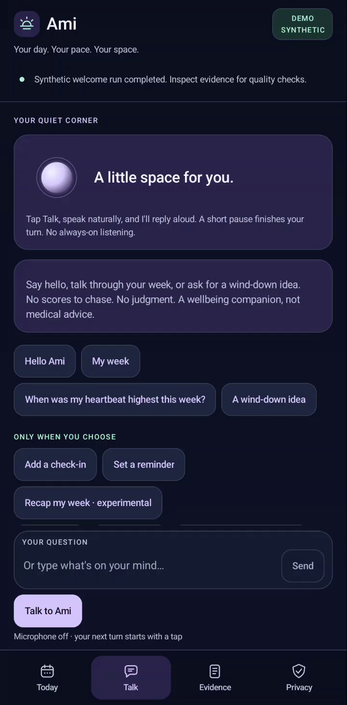
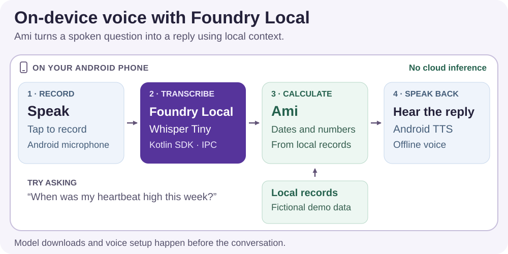

# Building an On-Device Voice Companion with Foundry Local

*A hands-on Android walkthrough combining local speech recognition, personal context and spoken replies—without cloud inference.*

“When was my heartbeat high this week?”

That was the question I wanted to ask my phone. My watch already collects the readings. But finding the answer still means opening an app, choosing a date range and interpreting a chart. I wanted to say the question out loud and hear an answer based on the records, without sending that conversation to a cloud model.

I built **Ami** to explore that experience with **Foundry Local for Android**. You tap to speak, Ami transcribes the question on the phone, looks up the relevant local context and reads the answer back. You can check the underlying numbers or ask a supported follow-up. The aim is a small, personal voice companion that feels comfortable to use, with an answer you can inspect.

This walkthrough uses fictional wearable records. You do not need a watch, a health account or access to anyone's personal data to reproduce it. The screenshots and recordings come from the Android app running on a Motorola g35; they are not interface mockups.



## Watch Ami answer

The recording below follows a complete voice turn: microphone input, Foundry Local transcription, an answer calculated from the sample records, and a spoken reply.

**Sound starts at 0:11**, when Ami begins its reply. The opening listening and transcription steps are silent in this recording.

<video controls preload="metadata" playsinline poster="./demo/ami-microphone.png" width="400">
  <source src="./demo/ami-microphone-preview.mp4" type="video/mp4">
  <source src="./demo/ami-microphone.mp4" type="video/mp4">
  Your browser cannot play this video. Use the MP4 link below.
</video>

[Watch or download the voice demo](./demo/ami-microphone-preview.mp4).

*For this repeatable test, the question was played from a laptop speaker into the phone's microphone. The soundtrack captures the phone's actual Android speech output, not the question or an added voiceover. Playback volume was increased during editing; the [recording notes](./demo/ami-microphone-provenance.json) describe the capture.*

The laptop is a build and recording tool here. It does not run the models or calculate the answer. Those operations happen on the phone.

Let's build that flow, then add a short recap using Foundry Local's chat API.

## Foundry Local on an Android phone

[Foundry Local](https://github.com/microsoft/FoundryLocalAndroid) lets an application run supported models on the device through an SDK. For Ami, the useful part is having model discovery, downloads, loading, speech transcription and chat completion available through Kotlin APIs. I can spend my application code on the interaction and the data, rather than implementing those model operations separately.

There are two Android deployment options. **IPC mode**, used in this project, talks to the separately installed Foundry Local service app. **Embedded mode** packages the runtime inside your application. Both use the same Kotlin API; their installation and process boundaries differ. The [deployment guide](https://github.com/microsoft/FoundryLocalAndroid/blob/v0.1.6/docs/IPC_AND_EMBEDDED_MODES.md) explains the trade-offs. Everything shown here uses IPC.

I pinned the Android SDK to **0.1.6** and used two packages from the device's catalog:

| Model | Job in Ami | Catalog identifier |
| --- | --- | --- |
| Whisper Tiny | Transcribe a spoken question | `openai-whisper-tiny-generic-cpu:4` |
| Qwen 2.5 0.5B Instruct | Select calculated facts for an optional recap | `qwen2.5-0.5b-instruct-generic-cpu:4` |

Both ran through the CPU execution provider on the test phone. Their combined advertised download size was 953 MB. These are the packages tested for this walkthrough, not a requirement to use the same models in every application.



Whisper is used on the voice path. Qwen is used only when the user requests the optional model-organized recap. The spoken reply comes from an installed **offline Android text-to-speech voice**. Keeping those calls separate makes it possible to change the voice without changing transcription, or try another chat model without changing how the app calculates a heart-rate maximum.

## Get the project running

The [Ami repository](https://github.com/kalai4390/ami-foundry-local) contains the Android app, Kotlin calculation code, sample records, tests and build scripts. It is currently a private review repository.

For this build, use JDK 17, Gradle 8.13, PowerShell 7.4 or newer, and Android SDK 36. The app requires Android 13 or newer; the recorded demo runs on Android 16. This is a native Android project, so there is no npm install or Docker container to set up.

Download the **IPC 0.1.6 AAR** from the [official release](https://github.com/microsoft/FoundryLocalAndroid/releases/tag/v0.1.6), and install the compatible Foundry Local companion app using the [IPC setup instructions](https://github.com/microsoft/FoundryLocalAndroid/blob/v0.1.6/docs/INTEGRATION_GUIDE.md#ipc-setup). The project checks the AAR's checksum before building.

From PowerShell, substitute your installed JDK, Gradle and AAR paths:

```powershell
git clone https://github.com/kalai4390/ami-foundry-local.git
cd ami-foundry-local

$env:JAVA_HOME = 'C:\tools\jdk-17'
$env:ANDROID_HOME = "$env:LOCALAPPDATA\Android"

.\scripts\build.ps1 `
  -GradlePath 'C:\tools\gradle-8.13\bin\gradle.bat' `
  -FoundryAar 'C:\tools\foundry-local-ipc-sdk-0.1.6.aar'
```

The script runs the core tests, builds the debug app and runs Android lint. With USB debugging authorized on the phone, install and open it:

```powershell
$adb = Join-Path $env:ANDROID_HOME 'platform-tools\adb.exe'
& $adb install -r .\app\build\outputs\apk\debug\app-debug.apk
& $adb shell am start -n dev.daylight.local/.MainActivity
```

Leave Ami in **Synthetic demo** mode. Open **Privacy → Prepare models**, and let setup finish on unmetered Wi-Fi. Then open **Talk**, choose an installed offline voice under **Voice & pace**, and tap **Talk to Ami**. Android asks for microphone permission when you use that feature. Health permissions are not needed for the sample conversation.

Try “When was my heart rate highest last month?” or “How did my sleep change this week?” You can also use **Play a sample conversation** to run a bundled audio fixture through transcription without using the microphone.

## Connect to the runtime and prepare the models

The SDK integration is in [FoundryRuntime.kt](../app/src/main/java/dev/daylight/local/inference/FoundryRuntime.kt). It begins with a manager and a compatibility check:

```kotlin
val manager = FoundryLocalManager.create(
    context = context.applicationContext,
    config = Configuration(
        appName = "Ami",
        disableTelemetry = true,
        logLevel = "Error"
    )
)
val compatibility = manager.checkCompatibility()
check(compatibility.isCompatible)
val catalog = manager.getCatalog()
val availableModels = catalog.listModels()
```

The SDK types come from `com.microsoft.foundrylocal.api`. `listModels()` shows what the catalog offers; `getModel()` gives the application a handle for a selected model. Here is the download step for Whisper:

```kotlin
val audioModel = catalog.getModel("openai-whisper-tiny-generic-cpu:4")
if (!audioModel.isCached()) {
    audioModel.download(timeoutMinutes = 10)
}
check(audioModel.isCached())
```

This belongs in setup, not in the question handler. Someone asking about their week should not unexpectedly start a large download. Ami's **Prepare models** action prepares both packages, shows progress, checks the download budget and requires the app to be in the foreground on unmetered Wi-Fi.

The model cache in IPC mode is isolated per client app. Downloading a model in another app does not establish that it is ready for Ami. Check the handle's cache state before enabling inference.

The snippets show the SDK calls without the surrounding UI code. The full adapter runs them off the main thread, serializes model operations and applies timeouts. If the service disconnects, it obtains a new manager and model handles. When the app finishes with a loaded model, it calls `unload()`; manager cleanup calls `close()`.

## Turn speech into a question

Ami records a short WAV after the user taps to speak. Once Whisper is cached, the transcription call is small:

```kotlin
if (!audioModel.isLoaded()) audioModel.load()

val transcription = audioModel.createAudioClient().transcribe(
    AudioTranscriptionRequest(
        filePath = audioFile.absolutePath,
        language = "en",
        temperature = 0.0f
    )
)
val question = transcription.text.trim()
```

`audioFile` is the local recording. Foundry Local loads Whisper on the phone and returns the transcript. There is no hosted speech endpoint in this flow.

[ShortRecorder.kt](../app/src/main/java/dev/daylight/local/inference/ShortRecorder.kt) handles recording, with a 20-second limit and explicit Done and Cancel controls. A short trailing pause can finish the turn too. Ami deletes the temporary microphone file after the turn or cancellation.

I kept the transcript visible, with **Edit heard question** beside it. A wrong word in a general chat can be annoying; a wrong date in a question about personal records can change the answer. Letting the person correct what Ami heard is a useful part of the voice interface.

## Answer from the records

Once the question is text, the app needs to resolve the date range and calculate the requested result. For “When was my heart rate highest last month?”, it selects the previous calendar month, finds the highest available sample and keeps its timestamp and time zone.


*The sample answer includes the reading, when it was recorded and how much of the month has data.*

The answer in this screenshot is 153 beats per minute, recorded on August 10, 2026. It also says that readings are available on only one of the month's 31 days. That qualification belongs with the answer: a maximum over one observed day is not a complete account of the month.

This is where I chose to use ordinary Kotlin rather than ask the language model to do the arithmetic. [HeartRateQueries.kt](../core/src/main/kotlin/dev/daylight/core/HeartRateQueries.kt) resolves the supported questions and follow-ups; [HeartRateAnalysis.kt](../core/src/main/kotlin/dev/daylight/core/HeartRateAnalysis.kt) calculates the result. The normal answer text is assembled from those results. Sleep and activity questions use the same approach of working from the records actually present.

Ami can keep the heart-rate question in context for a follow-up such as “What about last month?” It can also show the calculation behind the answer. It treats “high” as a request for the highest recorded sample, not a medical judgment, and it does not invent a cause when asked “Why?”

This division keeps Foundry Local focused on the work that needs a model: recognizing speech and, in the recap we'll add next, using a chat model to select facts. Dates and arithmetic remain straightforward to test.

## Give Ami a voice

A voice companion needs to be pleasant to listen to, not just able to produce text. Ami uses Android's text-to-speech engine with an installed voice that does not require a network connection. That selection happens in [LocalSpeaker.kt](../app/src/main/java/dev/daylight/local/inference/LocalSpeaker.kt), using the voice's [`isNetworkConnectionRequired()`](https://developer.android.com/reference/android/speech/tts/Voice#isNetworkConnectionRequired()) property along with installation and language checks.

**Voice & pace** offers Warm, Clear and Unhurried playback styles. These adjust how the Android voice speaks; they are not separate Foundry models. Here is the Warm preview generated on the phone:

<audio controls preload="metadata">
  <source src="./demo/ami-warm.wav" type="audio/wav">
  Your browser cannot play this audio. Use the WAV link below.
</audio>

[Listen to Ami's Warm voice](./demo/ami-warm.wav).

After a spoken question, Ami can speak the answer automatically. A typed question stays quiet. **Listen again**, **Stop voice** and **Interrupt & talk** let the user control the exchange without finding a settings screen. Those details make a bigger difference to the experience than adding another paragraph to the answer.

## Use the chat API for a weekly recap

The voice flow already works without a chat model. I also wanted to try a small local language model on the same device, so Ami includes a separate **Recap my week** action.

Before calling the model, the app calculates fact cards for the available activity, sleep and workout records. Each card has an ID, its calculated text and coverage information. With the user's confirmation, Ami passes the derived summaries to Qwen through Foundry Local's chat API:

```kotlin
val chatModel = catalog.getModel("qwen2.5-0.5b-instruct-generic-cpu:4")
check(chatModel.isCached())
if (!chatModel.isLoaded()) chatModel.load()

val response = chatModel.createChatClient().completeChat(
    ChatCompletionRequest(
        messages = listOf(
            ChatMessage.system(DebriefOrganizer.SYSTEM_PROMPT),
            ChatMessage.user(DebriefOrganizer.prompt(cards))
        ),
        temperature = 0.0f,
        maxTokens = 32,
        topP = 1.0f
    )
)
val recap = DebriefOrganizer.resolve(cards, response.message?.content)
```

Here, `cards` is the fact catalog created by the app. The prompt asks for two card IDs, such as `[1,2]`, rather than new health advice. [DebriefOrganizer.kt](../core/src/main/kotlin/dev/daylight/core/DebriefOrganizer.kt) accepts only a valid selection and renders the original calculated text. Extra prose, duplicate IDs and unknown cards are rejected; the app can display a clearly labelled computed recap instead.

This is a deliberately small experiment with chat completion. The model chooses cards; it does not generate the measurements or write the recap's sentences. Keeping the output short also gives the small model a manageable task.

<video controls preload="metadata" playsinline poster="./demo/ami-recap.png" width="400">
  <source src="./demo/ami-recap.mp4" type="video/mp4">
  Your browser cannot play this video. Use the MP4 link below.
</video>

[Watch or download the recap demo](./demo/ami-recap.mp4). *This separate screen recording is silent.*

Both model calls use the same Foundry Local integration: select a model, make sure it is cached, load it and create the appropriate client. Speech and chat solve different parts of the experience without needing a cloud inference service between them.

## Personal context without training on it

Ami's answers change when its local records change. That personalization does not require fine-tuning: the records supply the current context, while the model weights stay the same. A new sleep session should be available to a question about the week without retraining a model.

In the normal voice flow, Whisper receives the recording and application code handles the records. In the optional recap, Qwen receives derived fact cards after confirmation. Both model calls execute through the Foundry Local service on the phone; neither sends that content to a cloud model. SDK telemetry is disabled in the manager configuration, and the app has no cloud speech or inference fallback.

You still need connectivity to acquire the models. “Local” here describes how Ami processes a question, not a claim that every application on the phone has stopped using the network. The offline voice must also be installed before you use it.

The repository includes a [Health Connect reader](../app/src/main/java/dev/daylight/local/data/HealthReader.kt) for a wearable-backed version. This article stays with the working sample-data flow rather than presenting a live Samsung feed as part of the demo. Device setup and integration findings are kept in the [author guide](./AUTHOR-RUNBOOK.md#6-keep-personal-watch-integration-separate).

## Try it with your own application

The part I want to take further is the conversation around context that already belongs on a device. A journal could use the same speech entry point to retrieve a saved reflection. A learning app could let someone ask about their recent practice. Each needs its own data access and answer logic, but the Foundry Local model lifecycle and voice integration shown here are reusable.

For Ami, the next useful experiment would be a more flexible local conversation over the calculated facts. The existing voice loop gives that experiment somewhere concrete to start: a working microphone path, local transcription, an answer with inspectable context and speech the user can interrupt.

If you want to build along, start with the sample conversation and trace it through [FoundryRuntime.kt](../app/src/main/java/dev/daylight/local/inference/FoundryRuntime.kt). Then change one part: the records, a supported question or the recap prompt. That is a more useful starting point than an empty chat screen connected to a model.

- [Full Android project](https://github.com/kalai4390/ami-foundry-local) — source, sample data, tests and scripts; private during review.
- [Hands-on and capture guide](./AUTHOR-RUNBOOK.md) — setup, repeatable demos and publication steps.
- [Foundry Local Android API reference, pinned to 0.1.6](https://github.com/microsoft/FoundryLocalAndroid/blob/v0.1.6/docs/API_REFERENCE.md).
- [Recorded test and device results](./DEVICE-FINDINGS.md) — build versions, measurements and media provenance.
