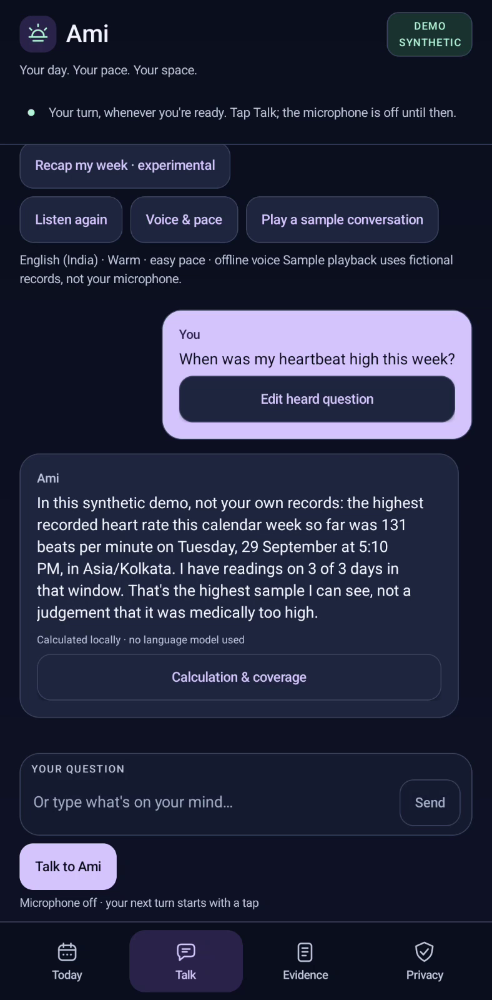

# Watch Ami

These recordings show Ami running on a Motorola g35 with fictional wearable records. To try it yourself, follow the [build guide](https://github.com/kalai4390/foundry-local-voice-companion/blob/main/docs/BUILD-GUIDE.md).

## Ask a question and hear the answer

[Watch Ami answer — 46 seconds, with voice](https://github.com/kalai4390/foundry-local-voice-companion/issues/1).

**Unmute the GitHub player and listen from 0:11.** Ami transcribes “When was my heartbeat high this week?” with Foundry Local Whisper, calculates the answer and speaks it using Android TTS.

For this repeatable recording, a laptop speaker played the question into the phone microphone. The soundtrack captures the phone's spoken reply, not the input question or added narration. The laptop does not run the model or calculate the answer.

## Try the weekly recap

The [22-second recap recording](https://github.com/kalai4390/foundry-local-voice-companion/blob/main/docs/demo/ami-recap.mp4) is a separate, silent screen capture. Download the MP4 from its GitHub file page to play it locally.

After confirmation, Qwen 2.5 0.5B runs through Foundry Local and selects two calculated fact cards. Ami validates the IDs and displays the original card text.

Other files include a [prerecorded speech test](https://github.com/kalai4390/foundry-local-voice-companion/blob/main/docs/demo/ami-audio.mp4) and a [Warm voice sample](https://github.com/kalai4390/foundry-local-voice-companion/blob/main/docs/demo/ami-warm.wav). The speech test is silent; the WAV is a separate introduction, not its soundtrack.

## Screenshots and diagrams

| Screenshot | What it shows |
| --- | --- |
| [Welcome](https://github.com/kalai4390/foundry-local-voice-companion/blob/main/docs/demo/ami-welcome.png) | Starting a voice turn |
| [Answer](https://github.com/kalai4390/foundry-local-voice-companion/blob/main/docs/demo/ami-answer.png) | A dated heart-rate answer and its coverage |
| [Today](https://github.com/kalai4390/foundry-local-voice-companion/blob/main/docs/demo/ami-today.png) | Activity and sleep at a glance |
| [Evidence](https://github.com/kalai4390/foundry-local-voice-companion/blob/main/docs/demo/ami-evidence.png) | The records behind a reply |
| [Privacy](https://github.com/kalai4390/foundry-local-voice-companion/blob/main/docs/demo/ami-privacy.png) | Model preparation and data controls |
| [Recap](https://github.com/kalai4390/foundry-local-voice-companion/blob/main/docs/demo/ami-recap.png) | Two selected fact cards |

The screenshots are cropped Android captures; the welcome image is a video frame. All show fictional records.

Use the landscape [voice flow](https://github.com/kalai4390/foundry-local-voice-companion/blob/main/docs/voice-flow.png) and [recap flow](https://github.com/kalai4390/foundry-local-voice-companion/blob/main/docs/recap-flow.png) at full article-column width. Editable SVGs are included alongside the PNGs.

## Recording details

| Files | App version | Capture details |
| --- | --- | --- |
| Microphone video and poster | 0.3.4-preview | [Voice recording notes](https://github.com/kalai4390/foundry-local-voice-companion/blob/main/docs/demo/ami-microphone-provenance.json) |
| Screenshots, silent videos and voice introduction | 0.3.3-preview | [Media notes](https://github.com/kalai4390/foundry-local-voice-companion/blob/main/docs/demo/ami-provenance.json) |

The microphone clip was cropped, resampled to 20 fps, trimmed after the conversation and amplified by 24 dB. No narration was added and inference was not sped up. Its H.264/AAC file is the one uploaded to GitHub; an MP3-audio copy is included for editors whose preview cannot decode AAC. The recordings include test setup time and are not latency benchmarks.

To capture your own conversation, use the [recording guide](https://github.com/kalai4390/foundry-local-voice-companion/blob/main/docs/RECORDING-GUIDE.md).
